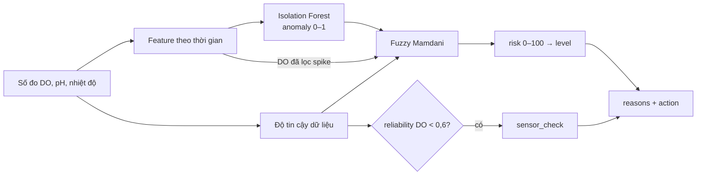

# Thiết kế mô hình AI — PondGuard

> Status: v1 · 14/11/2026 · Đối chiếu source `0e71707`. Mô tả mô hình **đang chạy** trong `ai/pondguard/`.
> Kết quả đo: [`eval/results/report.md`](../eval/results/report.md). Kiến trúc chung: [`docs/architecture_diagram.md`](../docs/architecture_diagram.md).

## 1. Bài toán

Từ chuỗi số đo cảm biến của một ao (chủ yếu oxy hòa tan DO), mỗi điểm đo trả về:

- `risk` 0–100 và `level` ∈ `SAFE` / `WATCH` / `DANGER`;
- `sensor_check`: dữ liệu DO không đáng tin → báo "Kiểm tra cảm biến" thay vì "Nguy hiểm";
- `reasons[]` (tối đa 3 câu tiếng Việt) và `action` (một hành động gợi ý).

Ý chính: **bất thường không đồng nghĩa với nguy hiểm**. Một biến động lạ có thể do môi trường thay đổi hoặc do cảm biến hỏng; hệ thống phải tách hai trường hợp này.

## 2. Dữ liệu

| Hạng mục | Nội dung |
|---|---|
| Nguồn | Kaggle `ogbuokiriblessing/sensor-based-aquaponics-fish-pond-datasets` — cảm biến IoT ao cá aquaponics (Nigeria) |
| Không có trong repo | `ai/data/` bị gitignore. Muốn chạy lại phải tải dữ liệu (lệnh ở [`ai/README.md`](../ai/README.md)) |
| Tiền xử lý | Gom về bước 10 phút, lấy đoạn liên tục dài nhất của mỗi ao, bỏ ao có dưới 24 giờ |
| Chia train/test | Mỗi ao: 50% đầu (sạch) để train, 50% sau chèn sự cố có nhãn để test |
| Ao bị loại | Ao 2: cảm biến DO kẹt thật → giữ làm ví dụ demo "cảm biến lỗi thật". Ao 8: lỗi định dạng thời gian. Ao 10–12: quá ngắn ([data_summary.csv](../ai/reports/data_summary.csv)) |

**Lưu ý:** [REPORT.md](../ai/reports/REPORT.md) ghi nền đánh giá là ao 1, 3, 4, 6, còn `data_summary.csv` đánh dấu thêm ao 7 và 9 là `used`. Hai file có thể đến từ hai lần chạy khác nhau. Cần chạy lại `run_pipeline.py` và chốt một bản trước khi trình bày.

### Sự cố được chèn ([inject.py](../ai/pondguard/inject.py))

| Loại | Nhãn | Mô tả | Độ dài |
|---|---|---|---|
| `do_drop` | rủi ro thật | Máy sục khí hỏng, DO sụt nhanh | 2–4 giờ |
| `do_decline` | rủi ro thật | DO giảm dần (tảo tàn, quá tải hữu cơ) | 5–8 giờ |
| `stuck` | lỗi cảm biến | Số đọc DO đứng yên | 2–5 giờ |
| `spike` | lỗi cảm biến | DO/pH nhảy vọt rồi bật về | 0,5–1 giờ |
| `sensor_drift` | chỉ dùng cho demo | Trôi hiệu chuẩn dần | — |

Mỗi ao test chèn 8 sự cố, không chồng lấn, cách nhau tối thiểu 3 giờ.

## 3. Pipeline suy luận

### 3.1. Feature ([features.py](../ai/pondguard/features.py))

- Giờ trong ngày dạng `sin`/`cos`.
- DO được lọc spike bằng trung vị trượt 3 điểm (chỉ nhìn về quá khứ): `do_s`.
- Trên `do_s`: chênh lệch so với điểm trước, độ lệch chuẩn trượt khoảng 1 giờ, độ lệch so với trung bình khoảng 4 giờ, độ dốc 1 giờ và 3 giờ, độ lệch so với **nhịp ngày đêm** của chính ao (trung vị theo giờ học từ nửa train).
- Mô hình chỉ dùng feature của DO. pH và nhiệt độ gần như không đổi trong bộ dữ liệu này nên chỉ thêm nhiễu.

### 3.2. Độ tin cậy dữ liệu (`reliability()`)

Tính riêng cho DO và pH, chỉ dùng dữ liệu quá khứ và hiện tại:

| Dấu hiệu | Điều kiện | Độ tin cậy |
|---|---|---|
| Đứng yên | Độ lệch chuẩn trong khoảng 1 giờ < 5% mức dao động bình thường của cảm biến đó | 0,2 |
| Nhảy vọt | Cách trung vị 5 điểm trước hơn 5 lần độ nhiễu (MAD), hoặc đổi nhanh hơn 15 mg/L/giờ (DO) / 6 đơn vị/giờ (pH) | 0,3 |
| Mất dữ liệu | Giá trị trống | 0,1 |

`reliability` của DO < 0,6 → `sensor_check = 1`. pH lỗi mà DO vẫn tốt → `other_sensor_issue = 1` (chỉ để hiển thị).

### 3.3. Isolation Forest

- `IsolationForest(n_estimators=200, contamination="auto", random_state=0)`, train trên feature đã chuẩn hóa của nửa train sạch.
- Điểm thô `-score_samples` được đưa về 0–1 bằng phân vị 50% và 99,5% của dữ liệu train.
- Gặp ao chưa thấy khi train → dùng nhịp ngày đêm trung vị của các ao train.

### 3.4. Fuzzy Mamdani ([fuzzy_risk.py](../ai/pondguard/fuzzy_risk.py))

Ngưỡng DO cho cá nước ấm lấy từ tài liệu và **cố định trước khi xem kết quả đánh giá**: dưới 3 mg/L nguy hiểm, 3–5 gây stress, trên 5 tốt.

| Biến | Tập mờ (hình thang) |
|---|---|
| DO (mg/L) | thấp ≤ 2,5 → 3,5 · vừa 2,5–5,5 · tốt ≥ 4,5 → 5,5 |
| anomaly | thấp ≤ 0,35 → 0,55 · cao ≥ 0,35 → 0,55 |
| reliability | thấp ≤ 0,4 → 0,6 · cao ≥ 0,4 → 0,6 |
| risk (0–100) | thấp 0–40 · vừa 25–70 · cao ≥ 55 → 75 |

| # | DO | anomaly | reliability | → risk | Ý nghĩa |
|---|---|---|---|---|---|
| 1 | thấp | bất kỳ | cao | cao | Oxy thấp, dữ liệu đáng tin → nguy hiểm |
| 2 | vừa | cao | cao | cao | Oxy rơi vào vùng stress theo kiểu bất thường |
| 3 | vừa | thấp | cao | vừa | Vùng stress nhưng theo nhịp bình thường (ví dụ rạng sáng) |
| 4 | tốt | cao | cao | vừa | Diễn biến lạ dù DO còn tốt → theo dõi |
| 5 | tốt | thấp | bất kỳ | thấp | Bình thường |
| 6 | bất kỳ | bất kỳ | thấp | thấp | Dữ liệu không tin được → **không** nâng lên nguy hiểm |
| 7 | thấp | bất kỳ | thấp | vừa | …trừ khi chính số đọc không tin được cũng rất thấp |

Giải mờ centroid. Mức: `risk ≥ 60` → DANGER, `≥ 40` → WATCH, còn lại SAFE.

### 3.5. Lời giải thích và hành động ([api/main.py](../api/main.py) `to_point`)

- Câu đầu tiên chọn theo DO: "DO thấp x mg/L", "DO lệch khỏi nhịp ngày đêm bình thường của ao", hoặc "DO x mg/L trong vùng gây stress (3–5)". Sau đó là các câu từ lớp độ tin cậy.
- Hành động: sensor_check → "Kiểm tra / vệ sinh cảm biến trước khi xử lý ao"; DANGER → "Bật máy sục khí ngay, kiểm tra cá nổi đầu"; WATCH → "Theo dõi sát trong 1 giờ tới".
## 4. Chính sách thông báo

Tách khỏi mô hình (`annotate_alerts`), để cảm biến dao động quanh ngưỡng không làm người nuôi bị báo liên tục:

| Loại | Phải kéo dài | Không lặp lại trong |
|---|---|---|
| `danger` | 2 điểm (20 phút) | 60 phút |
| `sensor` | 2 điểm (20 phút) | 4 giờ |
| `watch` | 3 điểm (30 phút) | 4 giờ; và tắt trong 4 giờ sau một lần `danger` |
| `resolved` | 3 điểm SAFE sau `danger` | 60 phút |

## 5. Vai trò của LLM

LLM ([llm_scenario.py](../api/llm_scenario.py)) **chỉ viết kịch bản**: đọc mô tả như "3 giờ sáng mất điện, máy sục khí ngừng" và trả về loại sự cố, giờ bắt đầu, cường độ. Số đo luôn là dữ liệu cảm biến thật cộng bộ chèn sự cố, nên dự đoán của mô hình không phải là lặp lại lời LLM. Kịch bản LLM chỉ dùng để demo, **không** dùng để tính Precision/Recall. Không có key hoặc gọi lỗi → dùng kịch bản mẫu theo từ khóa.

## 6. Giới hạn đã biết

- Trên bộ dữ liệu này **Isolation Forest gần như không đóng góp**: một mình chỉ đạt recall 0,01; Hybrid cho kết quả trùng với Fuzzy không dùng ML. Giá trị thực đến từ lớp độ tin cậy cộng Fuzzy.
- Khoảng 30% dữ liệu nền bị đánh dấu "không đáng tin" do cảm biến DO rất nhiễu. Trong các đoạn đó hệ thống không báo nguy hiểm: đúng nếu là nhiễu, nhưng có thể bỏ sót nếu là nguy cơ thật.
- `sensor_drift` trông giống hệt DO giảm dần thật, hệ thống không phân biệt được.
- Mô hình học trên ao aquaponics Nigeria; ngưỡng từ tài liệu nước ngoài, chưa được chuyên gia hoặc người nuôi Việt Nam xác nhận.
- Cá lớn dần làm DO nền giảm (concept drift), nên cần train lại định kỳ (xem báo cáo đánh giá).
