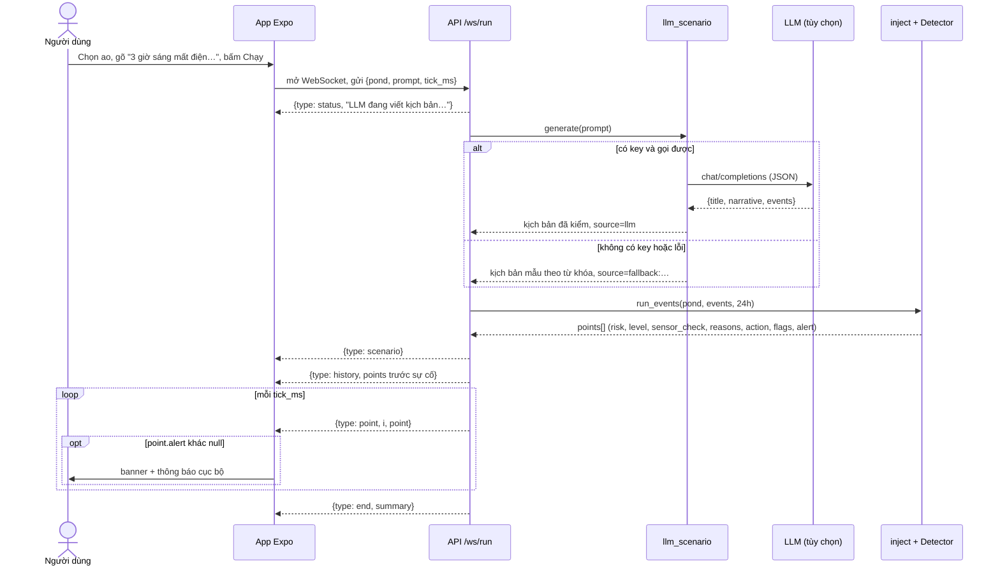
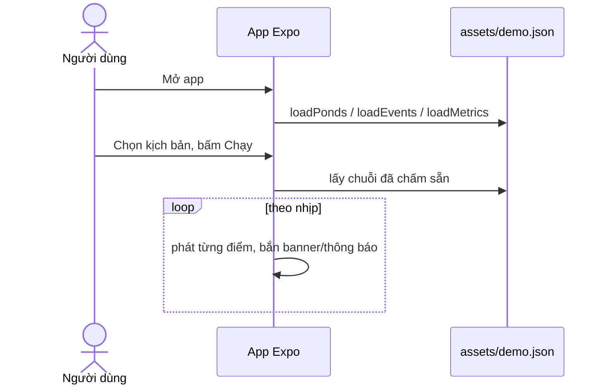

# Sơ đồ tuần tự — PondGuard

> Status: v1 · 14/11/2026 · Đối chiếu source `0e71707`.

## 1. Chạy real-time từ mô tả tình huống (chế độ live)

## 2. Chạy một sự cố chọn sẵn

Giống mục 1 nhưng app gửi `{pond, event, intensity}`; server tạo kịch bản một sự cố lúc `start_hour` (mặc định 12), không gọi LLM, `source = manual`.
Chọn ao `showcase` (ao 2) thì app chỉ gửi `{pond}`: phát lại dữ liệu lỗi cảm biến thật, không chèn sự cố.

## 3. Chế độ offline

`demo.json` được tạo bằng `python api/export_demo.py` từ mô hình thật, nhưng **không gọi AI khi chạy**. Chỉ dùng làm phương án dự phòng; khi trình diễn phải nói rõ là kết quả đóng gói sẵn.
