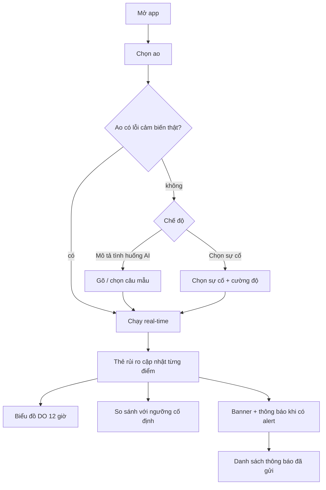

# Wireframe và luồng màn hình — PondGuard

> Status: v1 · 14/11/2026 · Màn hình trong [`mobile-expo/App.tsx`](../mobile-expo/App.tsx) (một màn hình cuộn).

## 1. Luồng người dùng



## 2. Wireframe (một màn hình cuộn)

Số trong khung chỉ để minh họa bố cục, không phải kết quả chạy.

```
┌────────────────────────────────────┐
│ PondGuard                 [Live]   │  ← nhãn Offline / Live
│ Dữ liệu cảm biến thật · sự cố giả lập│
├────────────────────────────────────┤
│ Ao                                 │
│ (IoTPond3) (IoTpond1) (IoTPond2 ·  │
│  cảm biến lỗi thật)                │
│ (✨ Mô tả tình huống) (Chọn sự cố) │
│ ┌────────────────────────────────┐ │
│ │ 3 giờ sáng mất điện, máy sục…  │ │  ← chỉ ở chế độ live
│ └────────────────────────────────┘ │
│ [▶ Chạy real-time]  [Dừng]         │
├────────────────────────────────────┤
│ Mất điện, máy sục khí ngừng        │  ← kịch bản + nguồn
│ Kịch bản do LLM viết · … lúc 8h    │
├────────────────────────────────────┤
│┏━━━━━━━━━━━━━━━━━━━━━━━━━━━━━━━━━━┓│
│┃ 14/11 03:20          [DANGER]    ┃│  ← viền theo màu mức
│┃ NGUY HIỂM                        ┃│
│┃ Điểm rủi ro 82/100               ┃│
│┃ DO 2.1 mg/L · bất thường 71% ·   ┃│
│┃ tin cậy 100%                     ┃│
│┃ • DO thấp 2.1 mg/L               ┃│
│┃ → Bật máy sục khí ngay, kiểm tra ┃│
│┃   cá nổi đầu                     ┃│
│┗━━━━━━━━━━━━━━━━━━━━━━━━━━━━━━━━━━┛│
│ DO 12 giờ gần nhất                 │
│ ╭──────╮     ╎                     │
│ │      ╰──╮  ╎   ← vạch sự cố      │
│ 3 ┄┄┄┄┄┄┄┄╰──╲┄┄ vùng đỏ < 3       │
├─────────────────┬──────────────────┤
│ Ngưỡng cố định  │ PondGuard        │
│ BÁO ĐỘNG        │ nguy hiểm        │
│ Báo đầu: +40'   │ Nguy hiểm: +50'  │
│                 │ Kiểm tra CB: —   │
├─────────────────┴──────────────────┤
│ Thông báo đã gửi (2)               │
│ ▌03:20 NGUY HIỂM: oxy trong ao     │
├────────────────────────────────────┤
│ Kết quả đánh giá (5 seed giữ riêng)│
│ Ngưỡng  0.58  2.4  26%             │
│ Hybrid  0.58  1.7  15%             │
└────────────────────────────────────┘
```

Màu: An toàn `#2a9d8f`, Cần theo dõi `#d4a017`, Nguy hiểm `#e63946`, Kiểm tra cảm biến `#f08a24`.

## 3. Ánh xạ màn hình ↔ API

| Phần màn hình | Nguồn dữ liệu |
|---|---|
| Danh sách ao | `GET /ponds` |
| Danh sách sự cố | `GET /events` |
| Kịch bản, thẻ rủi ro, biểu đồ, so sánh, thông báo | `WS /ws/run` (`scenario`, `history`, `point`, `end`) |
| Bảng đánh giá | `GET /metrics` |
