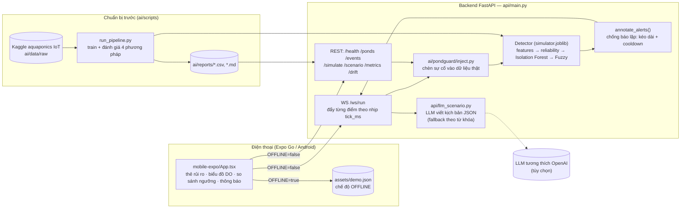

# Kiến trúc hệ thống — PondGuard

> Status: v1 · 14/11/2026 · Đối chiếu source `0e71707` (main).

## 1. Sơ đồ thành phần

## 2. Thành phần

| Thành phần | Vị trí | Trách nhiệm | Ghi chú |
|---|---|---|---|
| App Expo | [`mobile-expo/`](../mobile-expo/) | Chọn ao, chọn kịch bản (gõ tình huống cho LLM hoặc chọn sự cố), chạy real-time, hiển thị thẻ rủi ro, lý do, hành động, biểu đồ DO 12 giờ, so sánh với ngưỡng cố định, bảng số đánh giá, thông báo cục bộ | Expo SDK 58, React Native 0.88. Chọn live / offline trong [config.ts](../mobile-expo/config.ts) |
| API | [`api/main.py`](../api/main.py) | Nạp mô hình, chèn sự cố, chấm điểm, gắn cờ và cảnh báo, đẩy dữ liệu qua WebSocket | FastAPI, không lưu trạng thái |
| Viết kịch bản bằng LLM | [`api/llm_scenario.py`](../api/llm_scenario.py) | Biến mô tả tình huống tiếng Việt thành JSON `{title, narrative, events[]}` | LLM **không** sinh số đo. Không có key hoặc lỗi → kịch bản mẫu theo từ khóa |
| Bộ chèn sự cố | [`ai/pondguard/inject.py`](../ai/pondguard/inject.py) | Chèn `do_drop`, `do_decline` (rủi ro thật), `stuck`, `spike` (lỗi cảm biến), `sensor_drift` (chỉ để minh họa giới hạn) | Có nhãn để đo Precision/Recall |
| Detector | [`ai/pondguard/pipeline.py`](../ai/pondguard/pipeline.py) | Học nhịp ngày đêm, chuẩn hóa feature, Isolation Forest, ngưỡng độ tin cậy; `score()` trả anomaly, reliability, risk, level, sensor_check | Lưu bằng joblib, API nạp một lần |
| Fuzzy | [`ai/pondguard/fuzzy_risk.py`](../ai/pondguard/fuzzy_risk.py) | Mamdani 3 đầu vào, 7 luật, giải mờ centroid → risk 0–100 | Viết bằng NumPy, cùng ngữ nghĩa với scikit-fuzzy |
| Độ tin cậy dữ liệu | [`ai/pondguard/features.py`](../ai/pondguard/features.py) `reliability()` | Phát hiện đứng yên, nhảy vọt, mất dữ liệu chỉ từ dữ liệu quá khứ | Quyết định "Kiểm tra cảm biến" |

Chi tiết mô hình: [AI_MODEL_DESIGN.md](../deliverables/AI_MODEL_DESIGN.md). Endpoint: [API_DESIGN.md](../deliverables/API_DESIGN.md).

## 3. Luồng dữ liệu một lượt chạy (chế độ live)

1. App mở WebSocket `/ws/run`, gửi `{pond, prompt}` hoặc `{pond, event, intensity}`.
2. Có `prompt` → LLM viết kịch bản (hoặc fallback). Có `event` → kịch bản một sự cố.
3. `run_events()` lấy 24 giờ dữ liệu cảm biến thật của ao, chèn sự cố, gọi `Detector.score()`.
4. `annotate_alerts()` gắn `flags` cho mọi điểm và `alert` cho điểm cần bắn thông báo.
5. Server gửi `scenario`, `history` (phần trước sự cố), rồi từng `point` theo nhịp `tick_ms`, cuối cùng `end` kèm tóm tắt so sánh với ngưỡng cố định.

Sơ đồ tuần tự: [SEQUENCE_DIAGRAMS.md](../deliverables/SEQUENCE_DIAGRAMS.md).
